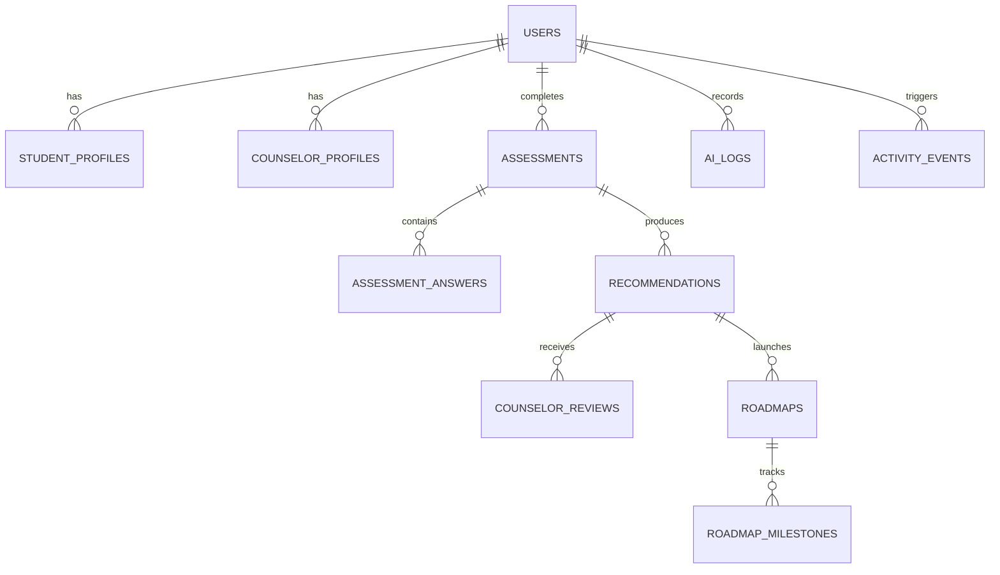

# PathFinder AI: Full-Stack AI-Integrated Career Guidance & Counseling Portal

> **Problem Statement PS-2 Solution**  
> A production-grade, full-stack career counseling platform combining **deterministic psychometric scoring (Holland RIASEC)**, **objective Skill Reality Check micro-quizzes**, **provider-agnostic LLM synthesis**, **human-in-the-loop counselor verification**, and an **interactive 10-week roadmap**.

---

## 🌟 Executive Summary & Unique Innovations

Most AI career apps suffer from hallucinations and black-box recommendations. **PathFinder AI** solves this with a **Grounded Hybrid Architecture**:

```
[Student Assessment] 
       │
       ▼
[Deterministic Scoring Engine] ── Holland RIASEC + Verified Skill Reality Check
       │
       ▼
[Curated Vector Shortlist] ───── Cosine similarity matching (Math, Tech, Healthcare, Law, Finance)
       │
       ▼
[LLM Gateway (Gemini API)] ──── Zero-PII Prompt + Strict JSON Schema Validation + Auto-Fallback
       │
       ▼
[Counselor Advisory Cell] ───── Human-in-the-Loop Review Queue ("Counselor Verified" Badge)
       │
       ▼
[Actionable Roadmap & Coach] ── Visual Radar Chart + 10-Week Trackable Milestones + AI Coach
```

### Key Differentiators (Why We Are Different)
1. **Grounded Hybrid AI Engine**: Interest and skill scores are computed in code and matched against a curated career dataset to create a shortlist. The LLM enriches only that shortlist (plus one wildcard), virtually eliminating hallucinations.
2. **Skill Reality Check Micro-Quizzes**: Every self-rated skill (1–5) is coupled with a 3-question objective micro-quiz. The engine detects inflated self-ratings and flags discrepancies to counselors as coaching opportunities.
3. **Human-in-the-Loop Oversight**: Human counselors review AI outputs, add personalized notes, and attach the official **"Counselor Verified"** badge.
4. **Visual Skill-Gap Radar & 10-Week Roadmap**: Interactive Recharts radar visualization contrasting verified skills against industry benchmarks. Students track weekly milestones with progress persistence and celebratory confetti.
5. **Context-Aware AI Career Coach**: A floating assistant grounded in the student's personal report, answering follow-up questions about syllabus, time management, and study resources.
6. **India-Aware & Multilingual**: Supports Class 10/12 stream choices (Science PCM/PCB, Commerce with Maths, Arts/Humanities), national entrance exams (**JEE, NEET, CUET, CLAT, CAT, UPSC**), government courseware (**NPTEL, SWAYAM**), and an instant **English / हिन्दी** toggle.
7. **Public Kiosk Deployment Mode**: Touch-optimized interface (48px+ targets), 90-second idle countdown timer with auto-reset for public privacy, and mobile QR hand-off.
8. **Privacy-First AI & Transparency**: Zero PII sent to third-party LLMs. Admin telemetry dashboard tracks model calls, token costs, latency, and fallback engine triggers.

---

## 🏗️ Technology Stack

| Layer | Technologies Used | Rationale |
|---|---|---|
| **Frontend** | React 18, Vite, React Router v6 | Fast, modular single-page architecture with sub-second HMR |
| **Styling & UI** | Vanilla CSS, Glassmorphism, Google Fonts (*Plus Jakarta Sans* & *Inter*) | Custom design system, responsive mobile-first, dark/light themes |
| **Data Visualization**| Recharts | Interactive Radar Charts and Analytics Funnels |
| **Micro-Interactions**| Lucide React, Canvas Confetti | Engaging feedback on milestone completion and status badges |
| **Backend API** | Node.js, Express.js (`/api/v1`) | RESTful modular architecture with centralized error handling |
| **Database** | SQLite via `better-sqlite3` (WAL Mode) | Zero-config, ultra-fast embedded SQL database with foreign keys |
| **Security & Auth** | JWT Access & Refresh Tokens, bcryptjs, Helmet, CORS, express-rate-limit | Strict RBAC guards (Student, Counselor, Admin) and DDoS protection |
| **AI Gateway** | Google Gemini 1.5 Flash + Grounded Rule Engine Fallback | Provider-agnostic gateway with PII stripper, JSON schema validation & 100% offline fallback uptime |

---

## 📊 Database Schema & Architecture

The database runs in SQLite WAL (Write-Ahead Logging) mode, enforcing relational integrity across 14 tables:



- **`users`**: Authentication credentials, roles (`student`, `counselor`, `admin`), last login.
- **`student_profiles`**: Education level, stream, grade, target language, career interests, AI consent.
- **`counselor_profiles`**: Institution, counselor specialization.
- **`questions`**: Assessment bank for Holland RIASEC, Skills with 3-question Reality Check micro-quizzes, and Work Values (with English and Hindi translations).
- **`assessments`**: Stores computed RIASEC scores (R, I, A, S, E, C percentages + 3-letter Holland code), verified skill levels, work values, and reality check gap analysis.
- **`careers`**: Curated dataset of career vectors, required skill thresholds, salary ranges, growth outlook, and Indian pathways.
- **`recommendations`**: AI-enriched recommendations, explainability breakdown, counselor review status, and verified badge.
- **`counselor_reviews`**: Audit trail of counselor actions (`approved`, `edited`, `commented`) and notes.
- **`roadmaps` & `roadmap_milestones`**: 10-week curriculum with weekly tasks, hour estimates, free NPTEL/SWAYAM resources, and completion state.
- **`ai_logs`**: Admin audit logs capturing sanitized prompts, token counts, latency in ms, active model, and fallback flag.

---

## 🔌 RESTful API Reference (`/api/v1`)

### Authentication & Portal Routing
- `POST /api/v1/auth/register` — Register student or counselor with role-specific parameters.
- `POST /api/v1/auth/login` — Authenticate user and issue JWT access token.
- `GET  /api/v1/auth/me` — Retrieve current active session and user profile.
- `POST /api/v1/auth/logout` — Terminate session.
- **Frontend Portals**:
  - `/login/student` — Dedicated Student Portal Sign In (with 1-click student demo accounts).
  - `/login/staff` (also `/login/counselor`, `/login/admin`) — Dedicated Counselor & Admin Portal Sign In.
  - `/login` — Unified Portal Hub with toggle tabs for Student and Staff.
- `GET  /api/v1/users/profile` — Fetch student or counselor profile details.
- `PUT  /api/v1/users/profile` — Update education stream, goals, or specialization.
- `GET  /api/v1/users/me/export` — **Data Portability**: Download full dossier JSON.
- `DELETE /api/v1/users/me` — **GDPR Right to be Forgotten**: Permanently erase all personal data.

### Assessment & Grounded AI Recommendations
- `GET  /api/v1/assessments/questions` — Retrieve 3-part question bank with English & Hindi text.
- `POST /api/v1/assessments` — Submit assessment responses, calculate Holland code and verified skills.
- `GET  /api/v1/assessments/latest` — Retrieve student's latest assessment and scores.
- `POST /api/v1/recommendations/generate` — Execute grounded scoring + LLM gateway enrichment.
- `GET  /api/v1/recommendations/latest` — Fetch latest recommendations with match percentages and review badge.

### 10-Week Roadmap & AI Career Coach
- `POST /api/v1/roadmaps/generate` — Initialize 10-week milestones for selected career.
- `GET  /api/v1/roadmaps/current` — Get active student roadmap and progress.
- `PATCH /api/v1/roadmaps/milestones/:id` — Toggle milestone checkbox and recalculate progress.
- `POST /api/v1/coach/chat` — Context-aware AI coach grounded in student's assessment and roadmap.

### Counselor Advisory Cell & Admin
- `GET  /api/v1/counselor/kpis` — Caseload metrics (total students, completed assessments, pending reviews).
- `GET  /api/v1/counselor/analytics` — Engagement funnel analysis (Registered -> Profiled -> Assessed -> Active).
- `GET  /api/v1/counselor/students` — Student list with early warning alerts (inactivity, skill gap).
- `GET  /api/v1/counselor/students/:id/brief` — **AI Counselor Copilot**: Student brief & discussion prompts.
- `POST /api/v1/counselor/reviews` — Commit review (`approved`, `edited`, `commented`) and assign badge.
- `GET  /api/v1/admin/ai-logs` — AI transparency telemetry (model, tokens, latency, fallback rate).

---

## 🚀 Quick Setup & Execution Guide

### Prerequisites
- **Node.js** v18+ or v24+
- **npm** v9+

### 1. Install & Seed
Clone or open the workspace and install root dependencies:
```bash
# Seed the database with demo accounts, assessment questions & curated careers
npm run seed
```

### 2. Start Application
Launch both backend REST API (`http://localhost:5000`) and frontend client (`http://localhost:5173`) with a single command:
```bash
npm run dev
```

Visit **`http://localhost:5173`** in your browser.

---

## 🔑 Pre-Seeded Evaluator Accounts (Instant 1-Click Access)

For effortless testing, the landing page and login screen include **1-Click Demo Buttons**:

| Role | Email | Password | Pre-loaded State |
|---|---|---|---|
| **Student (Ready)** | `rahul@pathfinder.ai` | `password123` | Class 12 Commerce. Assessment complete (`CEI`), recommendations ready, pending review in counselor queue. |
| **Student (Fresh)** | `student@pathfinder.ai` | `password123` | Class 12 Science (PCM). Ready to take fresh 3-part assessment. |
| **Counselor** | `counselor@pathfinder.ai` | `password123` | Dr. Vikram Seth. Has caseload, pending AI review queue, and AI Copilot brief. |
| **Admin** | `admin@pathfinder.ai` | `password123` | AI Gateway audit logs, tokens, latency benchmarks, and user registry. |

---

## 🗺️ Scripted 5-Minute Evaluator Walkthrough

1. **Landing Page (`/`)**: Inspect modern glassmorphism design, multilingual toggle (**ENG / हिन्दी**), and dark/light theme switch.
2. **Student Recommendations & Radar (`/recommendations`)**:
   - Click **'Student (Ready)'** on the demo bar.
   - Review the **Holland Code badge (`CEI`)**.
   - Inspect the **Visual Skill-Gap Radar Analysis** comparing student skills to career requirements.
   - Expand the **'Indian Pathway & Entrance Exams'** accordion to see exams (CUET, IPMAT, CAT) and NPTEL free courses.
3. **10-Week Actionable Roadmap (`/roadmap`)**:
   - Click **'Launch 10-Week Roadmap'**.
   - Check off a milestone; observe real-time progress bar recalculation and persistent state.
4. **Context-Aware AI Career Coach**:
   - Click the floating **'Ask AI Coach'** button.
   - Click a prompt chip (e.g. *"Which Indian entrance exam should I prioritize first?"*).
   - Review personalized advice grounded in the student's profile.
5. **Counselor Review & Verification (`/counselor`)**:
   - Log out and click **'Counselor Hub'**.
   - Review KPIs and the student engagement funnel.
   - Click **'Review & Verify'** for Rahul Verma.
   - View the **AI Counselor Copilot** summary, select **'Approve & Attach Counselor Verified Badge'**, and commit review.
   - The student's report now carries the green **Counselor Verified Advice** badge!
6. **Public Kiosk Mode (`/kiosk`)**:
   - Click the Kiosk link to experience full-screen mode with 48px+ touch targets, 90s idle auto-reset, and QR hand-off to mobile.

---

## 🛡️ Security & Privacy Compliance

- **Zero-PII Transmission**: Personal identifiers (names, emails, student IDs) are stripped in the LLM Gateway before external AI synthesis.
- **Data Protection Compliance**: Student data can be exported in one click or permanently erased through the self-service **"Delete All My Data"** (Right to be Forgotten) feature.
- **Fail-Safe Reliability**: The application includes a deterministic hybrid fallback engine. If third-party LLM APIs experience rate limits, latency, or outages, recommendations continue to generate instantly without crashing.

---

## 📄 License & Team
Developed for **PS-2: Full-Stack AI-Integrated Career Guidance & Counseling Portal**.  
All rights reserved © 2026 PathFinder AI Team.
